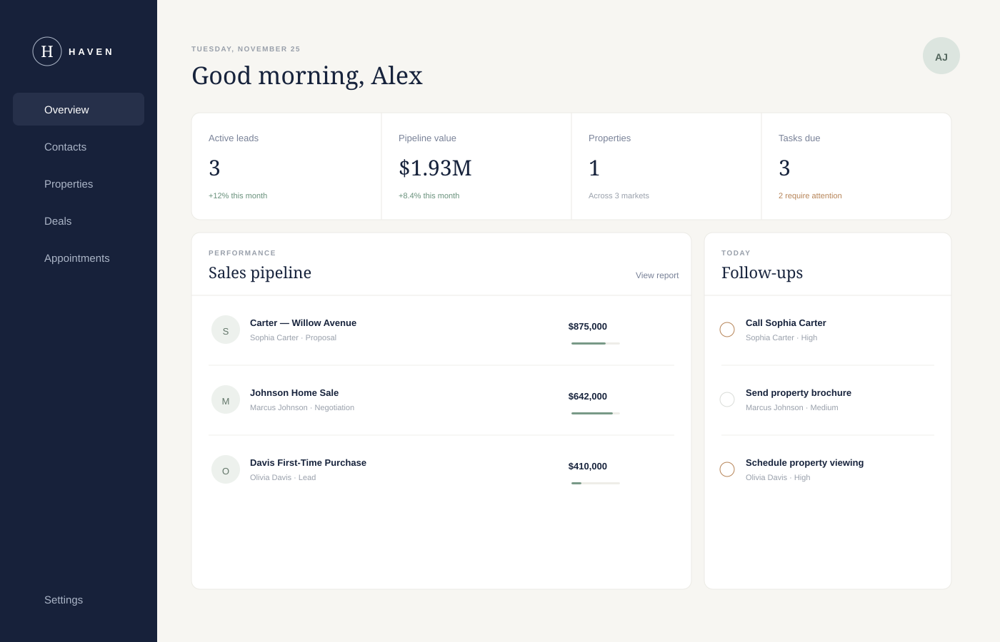

# Gharana Realty CRM

A refined CRM dashboard for Indian real-estate brokerages—built to keep client relationships, property mandates, transactions, and follow-ups in one thoughtful workspace.

## Dashboard preview



## Built for Indian property professionals

- INR pricing with Indian number formatting
- Client and seller relationship tracking
- Property inventory and transaction pipeline
- Follow-ups with priority and due dates
- Mumbai-focused sample listings and demo records
- Responsive layout for desktop and mobile

## Local setup

```bash
npm install
cp .env.example .env
npm run db:push
npm run db:seed
npm run dev
```

Set `DATABASE_URL` in `.env` to a PostgreSQL connection string. Then open `http://localhost:3000`.

## Scripts

- `npm run dev` — start the development server
- `npm run db:push` — sync the Prisma schema
- `npm run db:seed` — load Indian-market demo data
- `npm run build` — production build
